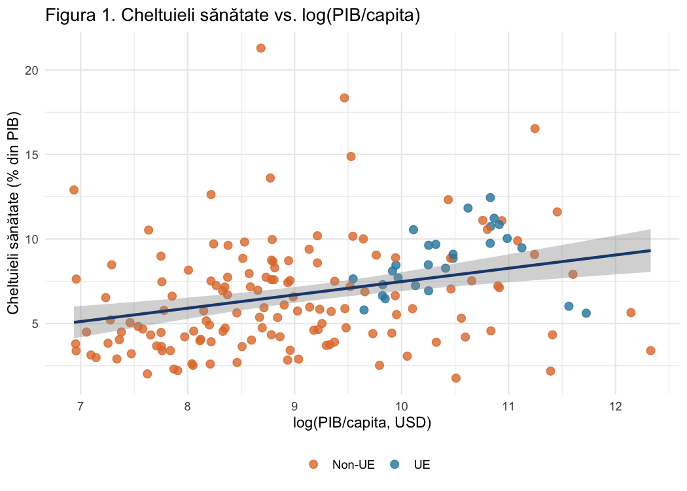
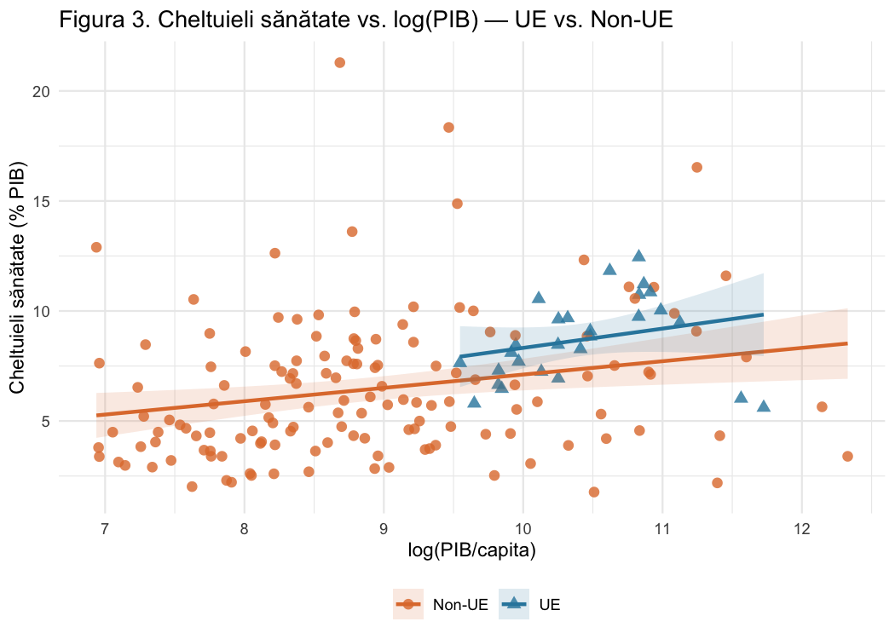

# What drives health spending across countries? A regression analysis in R

In this project we looked at why some countries spend a much larger share of their GDP on health than others. We used World Bank data for 2022 on 168 countries and focused on three factors: how rich a country is (GDP per capita), how old its population is (share of people aged 65 and over) and whether it is an EU member. We also tested whether the link between income and health spending is different inside the EU.

Richer countries do spend more on health as a share of GDP, but income alone explains little, under 10% of the variation. Once we add the share of older people, it becomes the stronger factor and GDP is no longer significant on its own. The two move together (correlation 0.695), so much of what looked like an income effect is really an ageing effect. EU membership has no significant effect once income and age structure are taken into account.

## Results

| Model | Variables | R² | Adj. R² | F |
|---|---|---|---|---|
| Simple | log(GDP per capita) | 0.097 | 0.091 | 17.73 |
| Multiple | + population 65+, EU dummy | 0.161 | 0.146 | 10.49 |
| Interaction | + log(GDP) x EU | 0.166 | 0.146 | 8.11 |

In the simple model, doubling GDP per capita goes with about 0.55 percentage points more health spending (slope 0.787, p < 0.001). In the multiple model, one extra percentage point of population aged 65+ goes with 0.155 points more health spending (p = 0.003). The interaction term is not significant (p = 0.321), so we kept the multiple model without it: same adjusted R², one parameter less.

## Method

All models are estimated by OLS. We checked heteroscedasticity with the White, Breusch-Pagan and Glejser tests, autocorrelation with Durbin-Watson and Breusch-Godfrey, normality of residuals with Jarque-Bera and Shapiro-Wilk, and multicollinearity with VIF (all values under 3). Homoscedasticity and non-autocorrelation hold. Normality is rejected, mostly because of a few countries with very high spending such as the US, so we also report HC3 robust standard errors for the simple model; the slope stays significant. The script also gives a point and interval forecast and compares the three models.

## Data and files

The data comes from the World Bank World Development Indicators for 2022: current health expenditure (% of GDP, SH.XPD.CHEX.GD.ZS), GDP per capita in current USD (NY.GDP.PCAP.CD) and population aged 65 and above (% of total, SP.POP.65UP.TO.ZS). Countries with GDP per capita under 1,000 USD were left out, which leaves 168 countries.

`analysis.R` runs the whole analysis and saves the figures to `figures/`. `get_data.R` downloads the data again from the World Bank with the `WDI` package, in case you want to rebuild `data/date_sanatate_2022.xlsx`. The full report (in Romanian) is in `report/`. To run the analysis, install the packages listed at the top of `analysis.R` and run `source("analysis.R")` from the project folder.

## Literature

Baltagi, B. H., Moscone, F. and Tosetti, E. (2012) Medical technology and the production of health care. Empirical Economics, 42(2), 395-411.

Gerdtham, U. G., Søgaard, J., Andersson, F. and Jönsson, B. (1992) An econometric analysis of health care expenditure: a cross-section study of the OECD countries. Journal of Health Economics, 11(1), 63-84.

Getzen, T. E. (2000) Health care is an individual necessity and a national luxury. Journal of Health Economics, 19(2), 259-270.

Gujarati, D. N. and Porter, D. C. (2009) Basic Econometrics. 5th ed. McGraw-Hill.

Nghiem, S. H. and Connelly, L. B. (2017) Convergence and determinants of health expenditures in OECD countries. Health Economics Review, 7(29).

Galoș Ioana, Florea Iulia Elena and Ene Maria Sara, Faculty of Cybernetics, Statistics and Economic Informatics, Bucharest University of Economic Studies, 2026. Coordinator: Prof. Mihaela Covrig.
